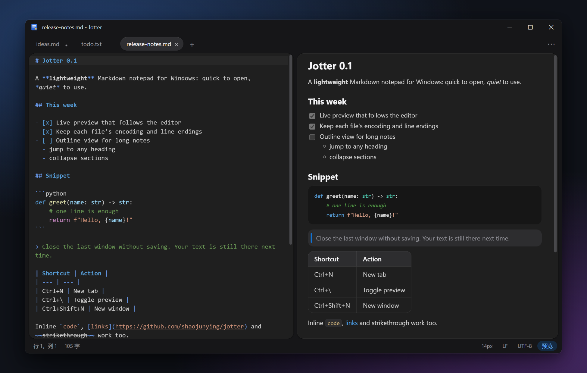
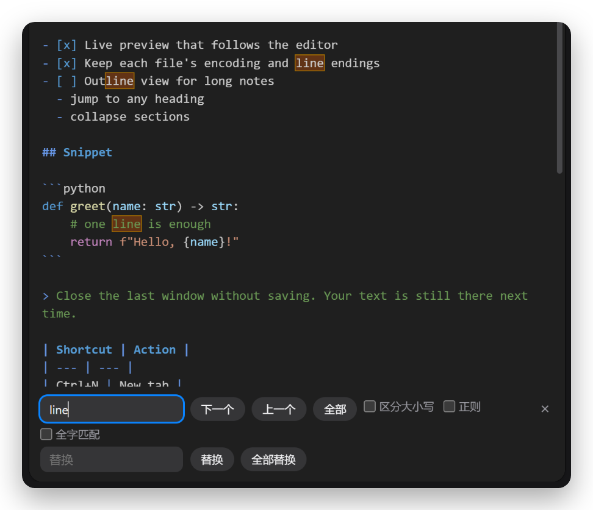
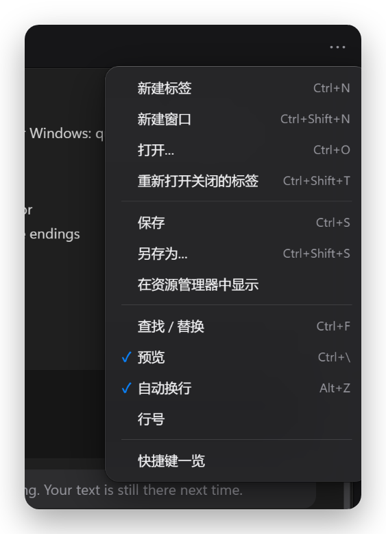
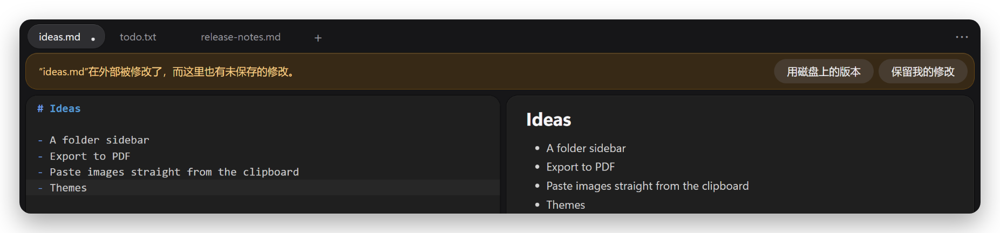

<p align="center">
  
</p>

<h1 align="center">Jotter</h1>

<p align="center">
  A lightweight Markdown notepad for Windows: tabs, a live preview, and nothing you type is ever lost.
</p>

<p align="center">
  <a href="LICENSE"></a>
  
  
  
  
  <a href="https://github.com/shaojunying/jotter/stargazers"></a>
</p>

<p align="center">
  <b>English</b> · <a href="README.zh-CN.md">中文</a>
</p>

<p align="center">
  
</p>

**Jotter sits between Notepad and a full code editor.** Notepad has no Markdown and few comforts. Opening VS Code for a two-line note is overkill. Jotter opens fast and keeps every note in a tab. It renders Markdown next to what you type, and it never asks you to save before you close it. It installs per user in about 4 MB.

> The interface text is in Simplified Chinese.

## ✨ Features

- 📑 **Tabs and windows**: drag tabs to reorder, `Ctrl+Shift+N` for another window. Opening a file while Jotter runs adds a tab instead of a second app.
- 👀 **Live preview**: Markdown on the left, rendered on the right, scrolling together. Task lists, tables, code highlighting and local images.
- 💾 **Nothing is lost**: close the last window with unsaved text and it is there next time, even after a crash. Closing any other window asks first.
- 🔤 **Encodings kept**: UTF-8, UTF-8 BOM, UTF-16 and GBK files open correctly and are saved back the way they came, CRLF or LF. Change either from the status bar.
- 🔄 **Knows when files change**: a file edited elsewhere reloads by itself. If you also have unsaved edits, Jotter asks which version to keep.
- ⌨️ **Editor keys you already know**: multi-cursor, find and replace, move lines, `Ctrl+D` to select the next match, `Ctrl+B` / `Ctrl+I` / `Ctrl+K` for Markdown.
- 🎨 **Easy on the eyes**: VS Code's Dark Modern colours in rounded, Liquid Glass-style chrome, with a compact 14 px editor.

## 🖼️ A closer look

<table>
  <tr>
    <td width="50%"></td>
    <td width="50%"><br></td>
  </tr>
  <tr>
    <td><b>Find and replace</b> with case, regex and whole-word options.</td>
    <td><b>Save prompts and the menu</b>: rounded glass panels with capsule buttons.</td>
  </tr>
  <tr>
    <td colspan="2"></td>
  </tr>
  <tr>
    <td colspan="2"><b>Changed on disk while you were editing?</b> Pick the version to keep. Nothing is overwritten silently.</td>
  </tr>
</table>

## 🚀 Install

Requires Windows 11 (Windows 10 should work with the [WebView2 Runtime](https://developer.microsoft.com/microsoft-edge/webview2/)), the [.NET 10 SDK](https://dotnet.microsoft.com/download) and [Node.js](https://nodejs.org/).

```powershell
git clone https://github.com/shaojunying/jotter.git
cd jotter
pwsh -File .\install.ps1
```

This builds Jotter and installs it for the current user, no admin needed:

- the app goes to `%LOCALAPPDATA%\Programs\Jotter`, with a **Jotter** entry in the Start menu.
- `.md`, `.markdown` and `.txt` files get **Open with › Jotter**. Your default app is left alone.
- sessions, settings and logs live in `%LOCALAPPDATA%\Jotter`.

Run the same command again to update, or `pwsh -File .\install.ps1 -Uninstall` to remove it (your notes and sessions stay).

## ⌨️ Shortcuts

| Keys | Action | Keys | Action |
| --- | --- | --- | --- |
| `Ctrl+N` | New tab | `Ctrl+F` / `Ctrl+H` | Find / replace |
| `Ctrl+Shift+N` | New window | `Ctrl+D` | Select next match |
| `Ctrl+O` | Open | `Alt+↑` / `Alt+↓` | Move line |
| `Ctrl+S` / `Ctrl+Shift+S` | Save / save as | `Ctrl+B` / `Ctrl+I` / `Ctrl+K` | Bold / italic / link |
| `Ctrl+W` | Close tab | `Ctrl+\` | Toggle preview |
| `Ctrl+Shift+T` | Reopen closed tab | `Alt+Z` | Word wrap |
| `Ctrl+Tab`, `Ctrl+1`…`9` | Switch tab | `Ctrl+=` / `Ctrl+-` / `Ctrl+0` | Text size |

Drop files onto the window to open them.

## 🧱 How it is built

```
src/Jotter/   WPF host: windows, file I/O and encodings, sessions, single instance
web/          the editor UI: CodeMirror 6 + markdown-it + highlight.js, bundled by esbuild
tools/        icon, README images, and scripts that drive the app for testing
```

Each window is a WPF window that hosts a WebView2 page. The page talks to the host over a small JSON message bridge. The host shows the open and save dialogs, reads and writes files, and checks for outside changes. It also keeps one session file per window with the unsaved text. The page never touches the disk itself. The preview renders Markdown with raw HTML turned off.

## 🛠️ Development

```powershell
cd web; npm install; node build.mjs        # bundle the UI into src/Jotter/wwwroot
dotnet build ..\src\Jotter                 # build the host
```

- **UI only**: serve `src/Jotter/wwwroot` with any local web server and open it in a browser. Without the host, a built-in mock stands in for the file system.
- **End-to-end**: `tools\run-test-instance.ps1` starts the debug build with its own data folder and a DevTools port. Drive it with `node tools\cdp.mjs 9333 eval|type|key|shot ...`. Use `tools\win.ps1` to close or focus its windows.
- **README images**: take raw shots with `cdp.mjs shot`, then `python tools\make-readme-images.py <raw-dir>`.

## 📄 License

[MIT](LICENSE)
