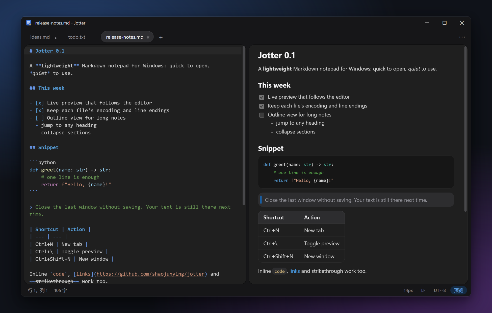
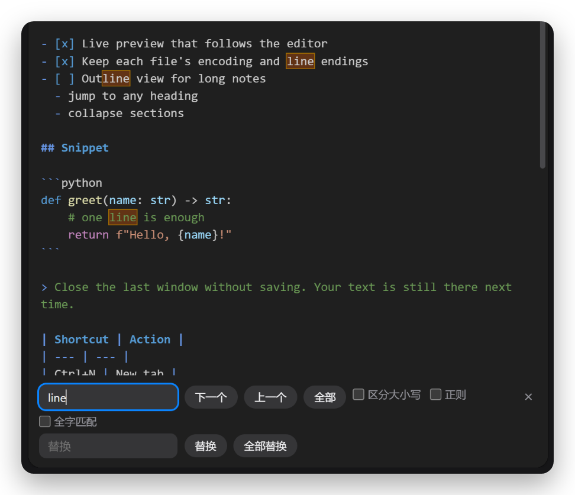
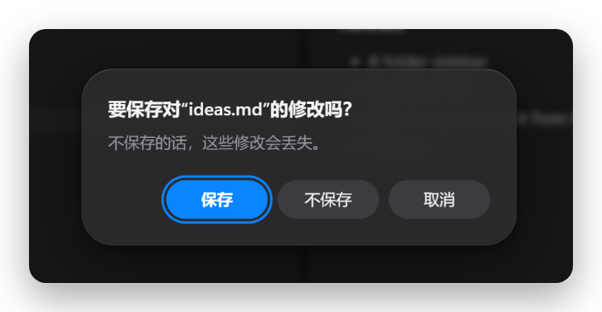
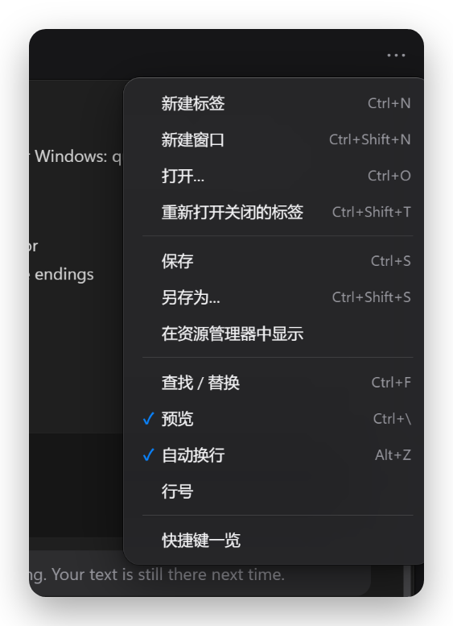
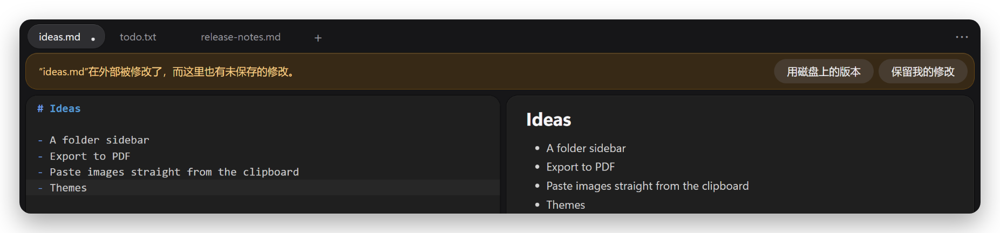

<p align="center">
  
</p>

<h1 align="center">Jotter</h1>

<p align="center">
  Windows 上的轻量 Markdown 记事本：多标签、实时预览，写下的内容不会丢。
</p>

<p align="center">
  <a href="LICENSE"></a>
  
  
  
  
  <a href="https://github.com/shaojunying/jotter/stargazers"></a>
</p>

<p align="center">
  <a href="README.md">English</a> · <b>中文</b>
</p>

<p align="center">
  
</p>

**Jotter 介于系统记事本和完整的代码编辑器之间。** 记事本不支持 Markdown，用起来也简陋；为了记两行笔记打开 VS Code 又太重。Jotter 打开快，每篇笔记一个标签，边写边看渲染效果。关闭窗口时不用先保存。按用户安装，大约 4 MB。

## ✨ 功能

- 📑 **多标签、多窗口**：标签可以拖动排序，`Ctrl+Shift+N` 新建窗口。Jotter 运行时再打开文件，会加成新标签，不会再启动一个程序。
- 👀 **实时预览**：左边写 Markdown，右边显示渲染结果，两边一起滚动。支持任务列表、表格、代码高亮和本地图片。
- 💾 **内容不会丢**：关闭最后一个窗口时，没保存的文字会存下来，下次打开时恢复。程序崩溃后也能恢复。关闭其他窗口时会先问你。
- 🔤 **保留编码**：UTF-8、UTF-8 BOM、UTF-16、GBK 文件都能正确打开。保存时保持原来的编码和换行符（CRLF 或 LF），也可以在状态栏里改。
- 🔄 **文件被外部修改时会处理**：没有未保存修改时自动重新加载。有未保存修改时，让你选择保留哪个版本。
- ⌨️ **熟悉的编辑器按键**：多光标、查找替换、移动行、`Ctrl+D` 选中下一个相同内容，`Ctrl+B` / `Ctrl+I` / `Ctrl+K` 编辑 Markdown。
- 🎨 **看着舒服**：配色用 VS Code 的 Dark Modern，界面是 Liquid Glass 风格的圆角设计，编辑区是紧凑的 14 px 字号。

## 🖼️ 细节

<table>
  <tr>
    <td width="50%"></td>
    <td width="50%"><br></td>
  </tr>
  <tr>
    <td><b>查找替换</b>：支持区分大小写、正则、全字匹配。</td>
    <td><b>保存提示和菜单</b>：圆角毛玻璃面板，胶囊形按钮。</td>
  </tr>
  <tr>
    <td colspan="2"></td>
  </tr>
  <tr>
    <td colspan="2"><b>编辑时文件在外部被改了？</b> 由你选择保留哪个版本，不会悄悄覆盖。</td>
  </tr>
</table>

## 🚀 安装

需要 Windows 11、[.NET 10 SDK](https://dotnet.microsoft.com/download) 和 [Node.js](https://nodejs.org/)。Windows 10 装上 [WebView2 运行时](https://developer.microsoft.com/microsoft-edge/webview2/) 后应该也能用。

```powershell
git clone https://github.com/shaojunying/jotter.git
cd jotter
pwsh -File .\install.ps1
```

脚本会构建 Jotter，并为当前用户安装，不需要管理员权限：

- 程序装在 `%LOCALAPPDATA%\Programs\Jotter`，开始菜单里有 **Jotter**。
- 右键 `.md`、`.markdown`、`.txt` 文件，可以在 **打开方式** 里选 Jotter。默认打开程序保持不变。
- 会话、设置和日志在 `%LOCALAPPDATA%\Jotter`。

再运行一次同样的命令就是更新。卸载用 `pwsh -File .\install.ps1 -Uninstall`，笔记和会话数据会保留。

## ⌨️ 快捷键

| 按键 | 作用 | 按键 | 作用 |
| --- | --- | --- | --- |
| `Ctrl+N` | 新建标签 | `Ctrl+F` / `Ctrl+H` | 查找 / 替换 |
| `Ctrl+Shift+N` | 新建窗口 | `Ctrl+D` | 选中下一个相同内容 |
| `Ctrl+O` | 打开 | `Alt+↑` / `Alt+↓` | 移动行 |
| `Ctrl+S` / `Ctrl+Shift+S` | 保存 / 另存为 | `Ctrl+B` / `Ctrl+I` / `Ctrl+K` | 加粗 / 斜体 / 链接 |
| `Ctrl+W` | 关闭标签 | `Ctrl+\` | 切换预览 |
| `Ctrl+Shift+T` | 重新打开关闭的标签 | `Alt+Z` | 自动换行 |
| `Ctrl+Tab`、`Ctrl+1`…`9` | 切换标签 | `Ctrl+=` / `Ctrl+-` / `Ctrl+0` | 字号 |

把文件拖进窗口即可打开。

## 🧱 实现方式

```
src/Jotter/   WPF 外壳：窗口、文件读写和编码、会话、单实例
web/          编辑器界面：CodeMirror 6 + markdown-it + highlight.js，用 esbuild 打包
tools/        图标、README 配图，以及测试用的驱动脚本
```

每个窗口是一个 WPF 窗口，里面是一个 WebView2 页面。页面通过一个小的 JSON 消息通道和外壳通信。外壳负责打开和保存对话框、读写文件、检查外部修改。外壳还为每个窗口保存一份会话文件，里面是没保存的文字。页面本身不直接访问磁盘。预览渲染 Markdown 时关闭了原始 HTML。

## 🛠️ 开发

```powershell
cd web; npm install; node build.mjs        # 把界面打包到 src/Jotter/wwwroot
dotnet build ..\src\Jotter                 # 构建外壳
```

- **只改界面**：用任意本地 Web 服务器提供 `src/Jotter/wwwroot`，在浏览器里打开。没有外壳时，内置的模拟数据会代替文件系统。
- **端到端测试**：`tools\run-test-instance.ps1` 启动调试版本，使用独立的数据目录，并打开调试端口。用 `node tools\cdp.mjs 9333 eval|type|key|shot ...` 驱动它，用 `tools\win.ps1` 关闭或激活窗口。
- **README 配图**：用 `cdp.mjs shot` 拍原始截图，再运行 `python tools\make-readme-images.py <原图目录>`。

## 📄 许可证

[MIT](LICENSE)
